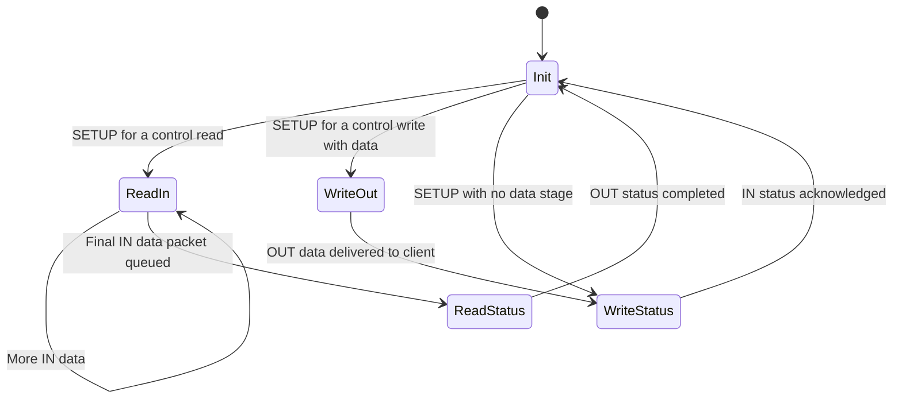

# RP2040 USB CDC transmit failure and driver corrections

## Observed behavior and confirmed result

The Raspberry Pi Pico enumerated as a CDC serial device on Windows 11, and the
host could send data to the Pico through endpoint 3 OUT. Data sent by the Pico
through endpoint 2 IN did not reach the host. The analyzer capture included an
incomplete bulk-IN transfer with zero bytes received.

After the changes to [chips/rp2040/src/usb.rs](../chips/rp2040/src/usb.rs), the
Pico successfully transmitted CDC data. The same hardware continued to work after
the original `line_coding && line_state` condition was restored in
[capsules/extra/src/usb/cdc.rs](../capsules/extra/src/usb/cdc.rs). Removing that
condition is therefore **not required for this fix**.

This document explains the driver changes relative to commit `54ce35516`
(`chips: rp2040: clear status bits`). The earlier working checkout also had
incorrect interrupt handling, so copying its `usb.rs` back would restore defects.

The hardware result establishes that the combined driver changes resolve the
reported case. It does not identify which individual defect triggered the
original failure. The timing examples below explain possible failure mechanisms;
they are not reconstructed packet-by-packet traces of that failure.

## How control transfers affect bulk transmission

The CDC setup requests use endpoint 0, although serial payloads use endpoints 2
and 3. In this CDC capsule, transmission becomes enabled only after the firmware
has processed the expected line coding and DTR assertion, followed by its
connection delay. An EP0 error can therefore prevent EP2 from being armed even
when EP3 reception works.

There is also a separate completion path for each bulk-IN packet:

```text
CDC requests transmission
  -> endpoint_resume_in(2)
  -> transmit_in(2) copies a packet into USB DPRAM and arms it
  -> the host reads the packet
  -> the controller reports EP2_IN completion in BUFF_STATUS
  -> handle_epdata_in(2) updates state and calls packet_transmitted(2)
  -> CDC can request the next packet or return the transmit buffer
```

Both paths matter: EP0 must deliver setup events correctly, and the bulk-IN state
must remain consistent with hardware completion events.

## 1. Acknowledge buffer completions before running handlers

### Previous behavior

The failing baseline already took a snapshot of `BUFF_STATUS`, dispatched its
handlers, and then wrote that snapshot back to acknowledge the interrupts.

`BUFF_STATUS` uses write-one-to-clear semantics. A written one clears the
corresponding pending bit; a written zero leaves it unchanged. Reading the
register does not acknowledge it. See the register description and Appendix A
in the [RP2040 datasheet](https://datasheets.raspberrypi.com/rp2040/rp2040-datasheet.pdf).

Acknowledging after dispatch leaves a race when a handler rearms the same
endpoint:

```text
1. Packet A completes; its endpoint status bit becomes 1.
2. Software snapshots that bit.
3. The handler arms packet B on the same endpoint.
4. Packet B completes before the interrupt handler finishes.
5. Software writes the old snapshot back, clearing the endpoint bit.
6. Packet B's completion has no remaining pending indication.
```

EP0 can arm its next IN packet inside its completion handler, making this more
than a theoretical ordering concern. A lost completion can leave software waiting
for an event that hardware has already delivered.

### Corrected behavior

`handle_buff_status()` now acknowledges the snapshot before dispatch:

```rust
let status: LocalRegisterCopy<u32, BUFF_STATUS::Register> =
    LocalRegisterCopy::new(self.registers.buff_status.get());
self.registers.buff_status.set(status.get());

// Dispatch handlers using status.
```

The snapshot still determines which events this invocation handles. A completion
from a newly armed packet can now set the bit again, and there is no trailing
write that erases it. Bits absent from the snapshot receive zeros and remain
pending if hardware sets them later.

[Raspberry Pi's low-level USB example](https://github.com/raspberrypi/pico-examples/blob/master/usb/device/dev_lowlevel/dev_lowlevel.c)
also acknowledges an endpoint's completion before invoking its handler.

### Why the older working driver was not a correct baseline

The older checkout mixed live reads with operations such as
`.modify(BUFF_STATUS::EP15_IN::CLEAR)`. A read-modify-write operation writes zeros
for the selected cleared field but also writes back ones from other pending
fields. On this register, those other ones acknowledge other endpoints, potentially
before their events have been handled. Its final `.set(0)` acknowledges nothing.

Thus, the older driver did not simply leave every status bit set forever. It
could clear bits as a side effect of attempting to clear another field. The fix
uses an explicit snapshot and acknowledgement order instead.

## 2. Track EP0 data and status stages separately

A control read such as `GET_LINE_CODING` sends data IN and finishes with a
zero-length OUT status packet. A control write such as `SET_LINE_CODING` receives
data OUT and finishes with a zero-length IN status packet. These are separate
stages, with completion notifications at separate times.

### Previous behavior

Several functions treated preparing a packet as if it completed the transfer:

- `transmit_in_ep0()` called `complete_ctrl_status()` immediately after arming
  the final IN data packet.
- The control-write setup path armed an IN status packet before receiving and
  delivering the OUT data.
- `handle_endepout(0)` treated EP0 OUT completions as control-write data, including
  the status packet of a control read.
- `handle_ep0datadone()` unconditionally set EP0 IN `AVAILABLE0` after processing
  an event, even when there was no new IN packet to send.

These operations could reset the CDC capsule's control state too early, deliver
an inappropriate `ctrl_out()` callback, or return a buffer to hardware without
preparing a new packet.

### Corrected states

The driver adds `CtrlState::WriteStatus` and gives the read and write paths
separate completion rules:

| State | Meaning | Action on the relevant completion |
| --- | --- | --- |
| `Init` | Waiting for a SETUP request | Select the requested transfer path. |
| `ReadIn` | Sending control-read data with more packets to prepare | An IN completion requests the next packet. |
| `ReadStatus` | Final IN data packet is queued, followed by OUT status | Final IN completion arms OUT status; OUT status completion finishes the transfer. |
| `WriteOut` | Waiting for control-write data | Copy and deliver the received data before preparing status. |
| `WriteStatus` | IN status packet is queued | Its IN completion finishes the transfer. |



`ReadStatus` covers both the outstanding final IN packet and the subsequent OUT
status wait. The final IN completion prepares the OUT status buffer; it does not
call `ctrl_status_complete()`.

### Control read: GET_LINE_CODING

1. `usb_handle_setup_packet()` selects `ReadIn` and starts the first IN packet
   with DATA1.
2. `transmit_in_ep0()` copies the response and selects `ReadStatus` when it queues
   the final packet. It does not report transfer completion.
3. When that packet completes, `handle_ep0datadone()` calls `ctrl_status()`, then
   arms a zero-length OUT status receive with DATA1.
4. `handle_endepout(0)` recognizes the OUT status completion and calls
   `complete_ctrl_status()`. It does not deliver the status packet to `ctrl_out()`.

### Control write: SET_LINE_CODING

1. The setup handler selects `WriteOut` and arms the initial OUT data receive
   with DATA1. It leaves the IN status packet unarmed.
2. `handle_endepout(0)` reads the actual received length, copies the bytes from
   DPRAM, and calls `client.ctrl_out()` with that length.
3. If the client accepts the data, the driver selects `WriteStatus`, calls
   `ctrl_status()`, and arms the zero-length IN status packet.
4. The host's acknowledgement produces an IN completion.
   `handle_ep0datadone()` then calls `complete_ctrl_status()`.

Requests without a data stage, including the existing set-address path, go
straight to `WriteStatus` and still wait for the IN status acknowledgement.

`complete_ctrl_status()` now sets EP0 to `Init` before notifying the client through
`ctrl_status_complete()`. Stage-entry notification through `ctrl_status()` occurs
when the driver prepares the status stage, rather than being delayed until the
completion helper runs.

## 3. Separate receiving preparation from consuming received data

Previously, `transmit_out_ep0()` both copied the old DPRAM contents and prepared a
new receive buffer. The completion handler called this helper before asking the
client to consume the packet. Preparing the next receive changed the buffer's
length metadata and returned ownership to hardware too early.

The responsibilities are now separate:

- `handle_endepout(0)` reads the completed packet's length and copies its bytes
  before invoking `ctrl_out()`.
- `transmit_out_ep0()` only prepares a receive. It uses a length of zero for
  control-read status and the configured buffer capacity for control-write data.
- PID selection uses `next_pid_out`, explicitly initialized to DATA1 for the
  initial control-write receive and the control-read status receive.

The helper writes buffer metadata, waits through the existing `nop_wait()`, then
sets `AVAILABLE0`. This preserves the existing separation between buffer
preparation and hardware ownership. The hardware requirements are described in
[RP2040 datasheet section 4.1.2.7.1](https://datasheets.raspberrypi.com/rp2040/rp2040-datasheet.pdf#page=386).

The patch also removes the panic for `CtrlInResult::Packet(0, ...)`, allowing a
client-provided zero-length control IN packet to pass through the normal arming
path.

## 4. Finish pending completions before processing the next SETUP

A host can complete one control transfer and immediately send the next SETUP.
The old transfer's status completion can arrive after the first `BUFF_STATUS`
snapshot but before software handles the new SETUP request.

`handle_interrupt()` now drains pending buffer completions before calling
`usb_handle_setup_packet()`. This lets the previous transfer finish before the
new SETUP replaces the shared control buffer and state. It also runs
`process_requests()` while draining, so a consumed completion does not leave
queued work waiting for an interrupt that may never arrive.

This addresses the ordering of a completed transfer followed by another SETUP;
it does not add a general mechanism for aborting an active control transfer.

## 5. Keep bulk-IN state consistent across callbacks and queued requests

### Publish the idle state before calling the client

`handle_epdata_in()` now changes `InData` to `Init` before calling
`client.packet_transmitted(endpoint)`.

A client may request another packet from that callback. With the endpoint already
idle, `endpoint_resume_in()` can arm it immediately. The new packet's `InData`
state is then preserved because the completion handler performs no state write
after the callback.

In the baseline, the callback saw the old `InData` state, so a resume request took
the queued-request path. Moving the state transition makes the completion state
visible before client code runs; this change alone is not evidence that the old
callback ordering caused the observed hardware failure.

### Leave queued requests pending while a packet is active

`process_requests()` now checks that a bulk-IN endpoint is in `Init` before taking
its pending transmit request. If the endpoint is still in `InData`, the request
remains queued.

Previously, an unrelated interrupt could cause `process_requests()` to consume
that request and call `transmit_in()` before the active packet completed. That
violates `transmit_in()`'s assertion that the endpoint must be idle.

### Dispatch IN completions consistently

EP1 IN and EP3 IN now use `handle_epdata_in()`, like EP2 IN and the other nonzero
IN endpoints. Their former `handle_endepin()` handler set `InData` without notifying
the client of completion; that helper is removed.

This is a related driver correction. The reported CDC payload uses EP2 IN and
EP3 OUT, so the EP1/EP3 IN dispatch change is not a direct explanation for that
particular symptom.

## 6. Acknowledge reset and setup flags explicitly

`handle_bus_reset()` now clears pending buffer status with
`buff_status.set(u32::MAX)`. The previous write of zero cleared no bits.

Acknowledgements of `SIE_STATUS.BUS_RESET` and `SIE_STATUS.SETUP_REC` now use
`write()` with only the intended flag. Using `modify()` could write back other
set write-one-to-clear flags and inadvertently acknowledge them too.

## Why the cdc.rs condition can remain unchanged

The retained condition is:

```rust
if line_coding && line_state {
    // Begin the connection delay before transmitting.
}
```

For this capsule, `line_coding` records receipt of 115200-baud line coding and
`line_state` records DTR assertion. The analyzer showed that the Windows host
requested 115200. Correct EP0 handling allows those requests to reach the capsule
and finish in the expected order.

Removing the line-coding requirement would permit other connection sequences,
such as DTR assertion without `SET_LINE_CODING` or with another baud rate. That is
a separate compatibility decision. The user's successful Pico test with the
original condition demonstrates that it is unnecessary for this repair.

## Validation and limits of the evidence

During the initial implementation:

- `make -C boards/raspberry_pi_pico` passed.
- `make clippy`, Rust formatting, and `git diff --check` passed.
- Ten host-side simulated checks covered completion acknowledgement ordering,
  EP0 read/write/status sequencing, a late status completion before the next
  SETUP, bulk callback rearming, queued sends, and CDC setup/transmission.
- The user subsequently confirmed Pico transmission on hardware, including after
  restoring the original CDC line-coding condition.

The simulations used a temporary harness with modeled registers and completion
injection. They were not tests of USB electrical timing, and the harness was not
added as a permanent repository test suite. These are historical validation
results, not checks rerun as part of writing this document.

The original analyzer image does not prove that EP2 entered a hardware halt. Its
incomplete IN transfer starts before the displayed DTR assertion; a pending host
read can legitimately have no data yet. The displayed STALL concerns EP4 IN.
The image also does not expose the exact interrupt ordering inside the Pico.

The hardware result supports the combined repair. Identifying a single original
trigger would require additional firmware-state or packet-level evidence.
